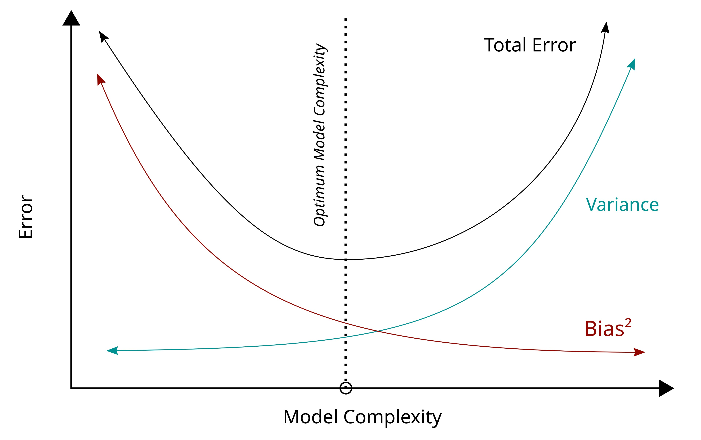
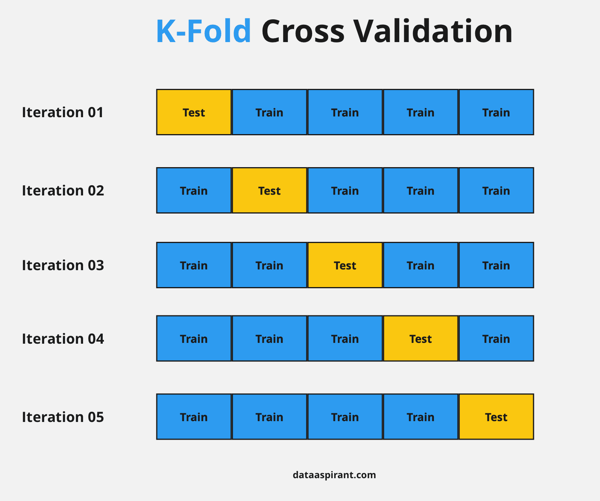
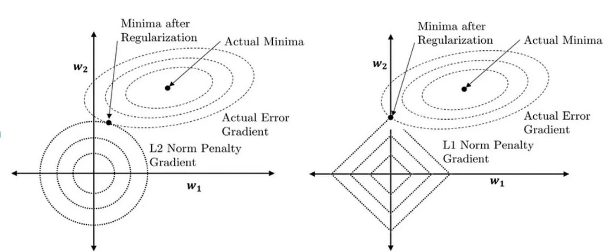
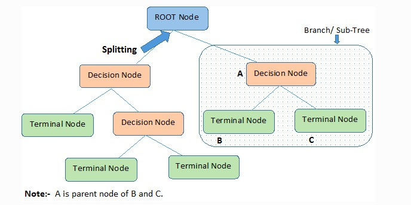
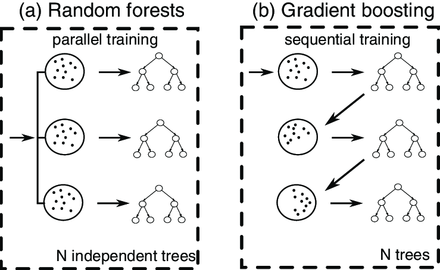
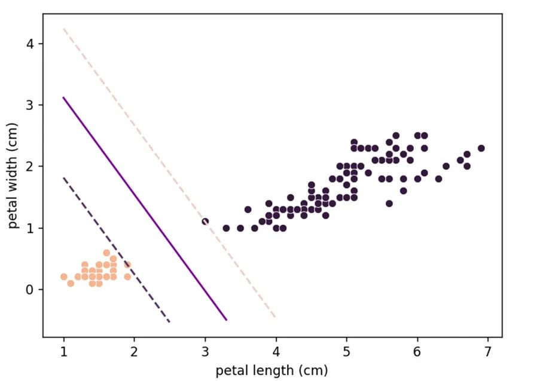

```{r, echo=FALSE}
library(caret)
library(boot)
library(tidyverse)
library(pROC)

boston <- read.csv("boston.csv") %>%
  na.omit()

penguins <- penguins %>% 
  na.omit() %>%
  mutate(female = ifelse(sex == "female", 1, 0))

options(width = 70)
```

# Outline

1.  Introduction

2.  Bias Variance Trade-Off

3.  Supervised vs Unsupervised Learning

4.  Cross-Validation

5.  Applications With Predictive Models

    1.  Ridge and Lasso Regression

    2.  Gradient Boosted

    3.  Tree-Based Methods

# Introduction

- With regression methods like simple or multiple linear regression, we are interested in **inference**

  - Interpreting relationships between one or more explanatory ($X_j$) variables and a response ($Y$)

- With predictive methods, we are interested in **minimizing** predicted error in our predicted $\hat{Y_i}$

  - Linear regression assumptions and multicollinearity are irrelevant!

  - How do we replicate predictive success with ordinarily hazardous models?

# Supervised vs Unsupervised Learning

- In unsupervised learning, the set of explanatory variables ($X_j$) **do not** observe the response ($Y$)

  - Grouping observations by similarities in their explanatory matrix

  - Principal component analysis (dimension reduction) and clustering algorithms

- In supervised learning, the set of explanatory variables ($X_j$) observe the response ($Y$)

  - Any type of regression model

  - The predictive models I will cover today!

# Supervised Learning

- We can think of a data set to model in terms of $Y$ and $X$ matrices.

$$
Y_{n \times 1} \mathbin{\&} X_{n \times p}
$$

- $n$: Number of observations

- $p$: Number of predictors

$$
Y_{n \times 1} = \begin{bmatrix} y_1 \\ y_2 \\ \vdots \\ y_n \end{bmatrix} \mathbin{,} X_{n \times p} = \begin{bmatrix} x_{1,1} & x_{1,2} & \cdots & x_{1,p} \\ x_{2,1} & x_{2,2} & \cdots & x_{2,p} \\ \vdots & \vdots & \ddots & \vdots \\ x_{n,1} & x_{n,2} & \cdots & x_{n,p} \end{bmatrix}
$$

- In predictive modeling, we are trying to minimize error in $\hat{Y_i}$ using our explanatory set $X_j$

# Variable Selection

- Predictive models often use high-dimensional data sets ($p$ is very large)

- In these cases, it's often necessary to perform **variable selection** to account for quality in variation explained in the response $Y$

- When interested in *inference*, variable selection procedures keep models simple but effective

- When interested in *prediction*, variable selection procedures improve repeated predictive success

# Bias-Variance Trade-off

- **Bias**: How well is the model fitting to its given data?

- **Variance**: How well does the model adjust to new data?

- Minimizing the total error (a function of these two) is the tenet of predictive modeling

{width="75%"}

# Cross-Validation

- Methods of ensuring consistent predictive success

- Involves splitting the data into **training** and **testing**/**validation** data sets

  - Models are built with training sets and validated with testing sets

  - Data split ensures strong, *reproducible* model results

- Let's discuss three methods of cross-validation

  1.  Validation-set approach

  2.  Leave-one-out cross-validation (LOOCV)

  3.  $k$-fold cross-validation

# Validation-Set Approach

- Dividing the data into one training set and testing/validation set

- Popular split is 80/20

  - 80% of the overall data goes into the training set and the other 20% is tested on

- Let's use the $\texttt{createDataPartition}\text{()}$ function in the $\texttt{caret}$ package

\footnotesize

```{r}
set.seed(1989) # For reproducability

train_index <- createDataPartition(y = boston$MEDV, p = 0.8, list = F)

nrow(boston[train_index,])/nrow(boston) # Percentage in training set

nrow(boston[-train_index,])/nrow(boston) # Percentage in testing set
```

# Leave-One-Out Cross-Validation

- LOOCV trains on a single observation and tests on the rest of the data set

- Typically reserved for data sets with fewer observations to conserve computational power

- Typically minimizes *bias* with high *variance*

- Let's use the $\texttt{cv.glm}\text{()}$ function in the $\texttt{boot}$ package

\footnotesize

```{r}
set.seed(1989) # For reproducability

mod <- glm(female ~ bill_len + bill_dep + flipper_len + body_mass, 
           data = penguins, 
           family = "binomial")

loocv <- cv.glm(data = penguins, glmfit = mod)

loocv$delta[2] # Bias-adjusted mean squared error
```

# $k$-Fold Cross-Validation

- Mix of validation set and LOOCV approaches

- Performing training and testing on $k$ subsets of data

- Reduces *bias* without extreme *variance*

- Application using a $\texttt{for}$ loop and the $\texttt{createFolds}\text{()}$ function from the $\texttt{caret}$ package to predict sex of penguins

{width="50%"}

# $k$-Fold Cross-Validation

\scriptsize

```{r}
set.seed(1989) # For reproducability
folds <- createFolds(penguins$female, k = 5, list = T, returnTrain = T)
fold_MSE <- numeric(5) # Dummy vector to store mean squared error

for (i in 1:5) {
  train_indices <- folds[[i]] # Each fold is a new training-testing run

  train_data <- penguins[train_indices, ]
  test_data <- penguins[-train_indices, ]

  mod <- glm(female ~ bill_len + bill_dep + flipper_len + body_mass, 
             data = train_data, 
             family = "binomial")

  pred <- data.frame(test_data, 
                     female_hat = predict(mod, test_data, type = "response"))

  fold_MSE[i] <- mean((pred$female - pred$female_hat)^2)
}

mean(fold_MSE) # Very similar to LOOCV!
```

# Testing Different Predictive Models

- We covered supervised learning and the importance of cross-validation and the bias-variance trade-off

- To put it all together, we will predict the median value of Boston homes in thousands of USD ($Y$) with 13 predictor variables ($X_1, \dots, X_{13}$)

  - We will create models using multiple linear, ridge, and lasso regression, gradient boosting, and random forest methods

  - We will test predictive accuracy using mean-squared error and cross validate using $k$ = 5 folds

# Multiple Linear Regression

- Since we want to mix predictive accuracy with simplicity, we should start with a linear model

  - No variable selection procedure performed

- Vector of $\hat{\beta}$ coefficients listed below

- $\text{MSE} = 24.2$ will be our baseline for future models

```{r, echo=FALSE}

set.seed(1989)

folds <- createFolds(boston$MEDV, k = 5, list = T, returnTrain = T)

glm_results <- tibble(
  fold = 1:5,
  coef = vector("list", 5),
  mse = NA_real_
)

for (i in 1:5) {
  
  train_indices <- folds[[i]]
  
  train <- boston[train_indices, ]
  test <- boston[-train_indices, ]
  
  mod <- lm(
    MEDV ~ ., 
    train
  )
  
  dfpred_lm <- data.frame(
    test, 
    pred = predict(mod, newdata = test)
  )
  
  glm_results$coef[[i]] <- as_tibble(coef(mod), rownames = "var")
  glm_results$mse[[i]] <- mean((dfpred_lm$MEDV - dfpred_lm$pred)^2)
  
}

```

\scriptsize

```{r}
glm_results$coef %>%
  bind_rows(.id = "fold") %>%
  group_by(var) %>%
  summarize(value = round(mean(value), 1)) %>%
  pull(var, value)

cat("Generalized linear model MSE:", mean(glm_results$mse))
```

# Ridge and Lasso Regression

- Ridge shrinks coefficient estimates towards zero by *squaring* the sum of the $\hat{\beta}$ coefficients

- Lasso shrinks coefficient estimates to zero by taking the *absolute value* of the sum of the $\hat{\beta}$ coefficients

  - Performs variable selection!

- Both methods require variable standardization ($z = \frac{x - \mu}{\sigma}$)

{width="90%"}

# Ridge Regression

- Ridge regression can be performed using the $\texttt{cv.glmnet}\text{()}$ function in the $\texttt{glmnet}$ package

  - $\alpha$ = 0 corresponds to the ridge penalty

  - This function automatically standardizes variables!

- $k$-fold cross-validation, and ridge procedures in corresponding R script

- $\text{MSE}$ = 26.9 \> 24.2 $\rightarrow$ worse than our generalized linear model

```{r, echo=FALSE}

library(glmnet)

set.seed(1989)

ridge_results <- tibble(
  fold = 1:5,
  coef = vector("list", 5),
  mse = NA_real_
)

for (i in 1:5) {
  
  train_indices <- folds[[i]]
  
  train <- boston[train_indices, ]
  test <- boston[-train_indices, ]
  
  x_train <- as.matrix(train[, -14])
  y_train <- train[, 14]
  
  x_test <- as.matrix(test[, -14])
  y_test <- test[, 14]
  
  cv_ridge <- cv.glmnet(
    x = x_train,
    y = y_train,
    family = "gaussian",
    alpha = 0
  )
  
  final_ridge <- glmnet(
    x = x_train,
    y = y_train,
    family = "gaussian",
    alpha = 0,
    lambda = cv_ridge$lambda.1se
  )
  
  dfpred_ridge <- data.frame(
    x_test, 
    pred = predict(
      final_ridge, 
      newx = x_test
    )
  )
  
  ridge_results$coef[[i]] <- as.matrix(coef(final_ridge), rownames = "var")
  ridge_results$mse[[i]] <- mean((y_test - dfpred_ridge$s0)^2)
  
}

```

\scriptsize

```{r}

round(rowMeans(do.call(cbind, ridge_results$coef)), 1) # Model coefficients

cat("Ridge Regression MSE:", round(mean(ridge_results$mse), 1))

```

# Lasso Regression

- Lasso regression can also be performed using the $\texttt{cv.glmnet}\text{()}$ function in the $\texttt{glmnet}$ package

  - $\alpha$ = 1 corresponds to the lasso penalty

  - In addition to automatic standardization, this function performs variable selection!

- $k$-fold cross-validation and lasso procedures in corresponding R script

- $\text{MSE}$ = 27.3 \> 24.2 $\rightarrow$ worse than our generalized linear model

```{r, echo=FALSE}

set.seed(1989)

lasso_results <- tibble(
  fold = 1:5,
  coef = vector("list", 5),
  mse = NA_real_
)

for (i in 1:5) {
  
  train_indices <- folds[[i]]
  
  train <- boston[train_indices, ]
  test <- boston[-train_indices, ]
  
  x_train <- as.matrix(train[, -14])
  y_train <- train[, 14]
  
  x_test <- as.matrix(test[, -14])
  y_test <- test[, 14]
  
  cv_lasso <- cv.glmnet(
    x = x_train,
    y = y_train,
    family = "gaussian",
    alpha = 1
  )
  
  final_lasso <- glmnet(
    x = x_train,
    y = y_train,
    family = "gaussian",
    alpha = 1,
    lambda = cv_ridge$lambda.1se
  )
  
  dfpred_lasso <- data.frame(
    x_test, 
    pred = predict(
      final_ridge, 
      newx = x_test
    )
  )
  
  lasso_results$coef[[i]] <- as.matrix(coef(final_lasso), rownames = "var")
  lasso_results$mse[[i]] <- mean((y_test - dfpred_lasso$s0)^2)
  
}

```

\scriptsize

```{r}

round(rowMeans(do.call(cbind, lasso_results$coef)), 1) # Model coefficients

cat("Lasso Regression MSE:", round(mean(lasso_results$mse), 1))

```

# Tree-Based Methods

- Creating simple splits in predictor variables ($X_j$) based on trends in the response ($Y$)

  1.  Start with a **root node**, which makes the first split

  2.  Subsequent splits are denoted at **decision nodes**

  3.  When no more splits are made, the resulting model coefficient is called a **terminal node**

- In building decision trees, tree-based models automatically perform variable selection

{width="50%"}

# Random Forest vs Gradient Boosting

- Random forest models build decision trees on independent subsets of the data and average predictions

- Gradient boosting builds sequential models to fix previous error and stops when performance stops improving

{width="80%"}

# Random Forest Model

- Built using the $\texttt{randomForest}\text{()}$ function in the $\texttt{randomForest}$ package

- Model coefficients measured by **residual sums of squares** (RSS = $\sum_{i=1}^n (y_i - \hat{y_i})^2$)

  - A variable's RSS measures its variance reduction across each node split

```{r, echo=FALSE}

library(randomForest)

set.seed(1989)

rf_results <- tibble(
  fold = 1:5,
  influence = vector("list", 5),
  mse = NA_real_
)

for (i in 1:5) {
  
  train_indices <- folds[[i]]
  
  train <- boston[train_indices, ]
  test <- boston[-train_indices, ]
  
  mod_rf <- randomForest(
    MEDV ~ .,
    train,
    mtry = 3,
    ntree = 500
  )
  
  dfpred_rf <- data.frame(
    test,
    pred = predict(mod_rf, test)
  )
  
  rf_results$influence[[i]] <- as_tibble(importance(mod_rf, type = 2), rownames = "var")
  rf_results$mse[[i]] <- mean((dfpred_rf$MEDV - dfpred_rf$pred)^2)
  
}

```

\scriptsize

```{r}
rf_results$influence %>%
  bind_rows(.id = "fold") %>%
  group_by(var) %>%
  summarize(value = round(mean(IncNodePurity), 1)) %>%
  pull(var, value)

cat("Random Forest MSE:", round(mean(rf_results$mse), 1))
```

# Gradient Boosted Model

- Built using the $\texttt{gbm}\text{()}$ function in the $\texttt{gbm}$ package

- Model coefficients measured as **relative influence**

  - The amount of error each predictor variable reduced in subsequent boosted models

```{r, echo=FALSE}

library(gbm)

gbm_results <- tibble(
  fold = 1:5,
  influence = vector("list", 5),
  mse = NA_real_
)

for (i in 1:5) {
  
  train_indices <- folds[[i]]
  
  train <- boston[train_indices, ]
  test <- boston[-train_indices, ]
  
  mod_gbm <- gbm(
    MEDV ~ .,
    train,
    distribution = "gaussian",
    n.trees = 500,
    shrinkage = 0.01,
  )
  
  dfpred_gbm <- data.frame(
    test,
    pred = predict(mod_gbm, test)
  )
  
  gbm_results$influence[[i]] <- as_tibble(summary(mod_gbm, plotit = F))
  gbm_results$mse[[i]] <- mean((dfpred_rf$MEDV - dfpred_rf$pred)^2)
  
}

```

\scriptsize

```{r}
gbm_results$influence %>%
  bind_rows(.id = "fold") %>%
  group_by(var) %>%
  summarize(value = round(mean(rel.inf), 1)) %>%
  pull(var, value)

cat("Gradient Boosted MSE:", round(mean(gbm_results$mse), 1))
```

# Other Important Topics

- **Deep Learning**: Complex models built using neural networks (degrees of connected nodes)

  - Used in image classification and large language models (LLMs)

- **Support Vector Machines (SVM)**: Classification models that split groups of data in three-dimensional space using hyperplanes

{width="50%"}

# Thank You!

- Please visit the corresponding R script with more in-depth information about each topic

- Any questions? :)
